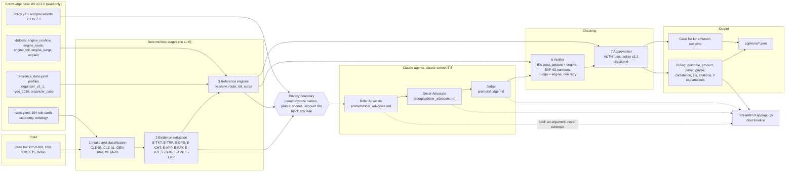

# FairRyde app: the hackathon MVP

A multi-agent pipeline that resolves a Ryde ride-hailing dispute and shows its work. It runs on the FairRyde knowledge base (`kb/`, v0.3.0, Ryde Dispute Resolution Policy v2.1) and its reference engines (`kb/tools/`), neither of which the app changes. Three Claude agents argue and rule; deterministic code classifies, extracts evidence, measures, verifies and sets the approval tier.

## Run it

```bash
pip install -r app/requirements.txt

streamlit run app/app.py                       # the UI: pick a case, press Run, watch the agents
python -m fairryde_app.cli DISP-001            # the same run in a terminal (run from the app/ folder, or set PYTHONPATH=app)
python -m pytest app/tests                     # 202 tests, offline
python app/tests/report.py                     # the table of required cases, written to app/tests/RESULTS.md
```

**Live or mock.** With `ANTHROPIC_API_KEY` set, the agents call the Claude API (`claude-sonnet-5-5`, override with `FAIRRYDE_MODEL`). Without a key the app replays saved responses from `app/mock_responses/`, so the demo always works offline. The sidebar can force either mode. Mock mode also has scenarios that change the saved Judge answer on purpose, to show the verifier at work: `judge_disagrees`, `bad_citation_fixed`, `bad_citation`, `low_confidence`, `late_safety_flag`.

**What the saved responses are.** DISP-001 to DISP-003 and the safety demo (DEMO-SAFETY-01) were recorded live with `claude-sonnet-5-5` on 16 Oct 2026 (`python -m fairryde_app.cli CASE --live --record`): they are the model's real answers, pseudonymized. In DISP-001 to DISP-003 only the three ruling entries are recorded; the three case file entries are still authored, because the live runs were in ruling mode, and they are replayed only when a mock run of the case switches to case file mode (`late_safety_flag`). Each of these files marks its provenance per entry (`provenance`). The other cases (E01 to E15) are authored: composed from the deterministic stages, so every citation in them is real. Every set passes the same verifier a live answer does. To record a case again: `python -m fairryde_app.cli DISP-001 --live --record`.

**The live path is tested.** The first live run (16 Oct 2026, the four cases above) gave the expected outcome, amount and tier in every case; on DISP-001 to DISP-003 the Judge agreed with the engine and passed the verifier on its first attempt, and the server-side refusal fallback was accepted. A case took 24 to 48 seconds for its three calls. `tests/test_live_client.py` also covers the live path offline with a fake client: the request shape (no sampling parameters, no forced tool use, JSON asked for in the prompt, server-side refusal fallback requested and dropped if the API rejects it), reply parsing, a refusal and an API outage.

Every run of a listed case is saved as a JSON log in `app/runs/` (the log holds the pseudonymized view only; other logs are git-ignored). Runs of edited and uploaded cases are not saved on the server; the visitor can download the run log. `app/runs/examples/` has the four live run logs of 16 Oct 2026 (`*_live_example.json`, one per case above) and the earlier mock-mode samples of the same four cases, made with the authored answers (`*_mock_example.json`).

## Try it

1. **Pick a listed case** (DISP-001 to DISP-003, E01 to E15, the safety demo) and press **Run**. Without live mode the agents replay their saved answers, and the result is compared with the expected one.
2. **Edit the complaint.** The text box under the case picker holds the case's complaint (`dispute_ticket.description`, in the pseudonymized view). Change it and press Run: the run uses a copy of the case with the new text, keeps the case's policy profile (an edited DISP case still runs under `organizer_v2_1`), and is labeled "edited case, no reference ruling" instead of being compared with the expected result.
3. **Upload a case.** Choose "Upload a case", download the example (a synthetic surge-fare dispute built from our own demo case in `app/sample_cases`, not from the organizer's files), change it, and upload it. The file must be one JSON object in the organizer's sample format, at most 1 MB; the app checks the format and runs the case adapter, the intake and the rules engine on it before it accepts it, and says what is wrong with a file that does not fit. An uploaded case runs under `organizer_v2_1`, is labeled "uploaded case, no reference ruling", and goes through the same pseudonymization and leak check before any model call.

**Live mode and the access code.** Edited and uploaded cases have no saved answers, so the three agents need live mode. The app reads `ANTHROPIC_API_KEY` and `LIVE_ACCESS_CODE` from Streamlit secrets, falling back to environment variables, and never shows or logs them. When `LIVE_ACCESS_CODE` is set, live mode runs only after the visitor enters that code in the sidebar; Auto mode never goes live without it. Without the code, a listed case replays its saved answers, and an edited or uploaded case runs the deterministic stages only (intake, evidence, rules engine) with a note that the three agents need the access code. A browser session gets at most 10 live runs; the sidebar shows how many are left (a page reload starts a new session).

### Deploy on Streamlit Community Cloud

- Repository `Jasperyu01/fairryde`, branch `main`, main file path `app/app.py`. Community Cloud runs the app from the repository root and installs `app/requirements.txt` (the requirements file next to the main file). Python 3.12 is what the deployment check used (Advanced settings).
- Secrets (Advanced settings, TOML):

  ```toml
  ANTHROPIC_API_KEY = "sk-ant-..."
  LIVE_ACCESS_CODE = "a code you hand out to the judges"
  ```

- `.streamlit/config.toml` at the repository root sets the upload limit to 1 MB.
- The repository is private: connect Community Cloud to a GitHub account that can read it, and after deploying check the app's sharing setting (who can view it). On a public app, the access code is what keeps the API key from being spent by strangers.

## Architecture



| # | Stage | Code | What it does |
|---|---|---|---|
| 1 | Intake and classification | `intake.py` | CLS-05 maps the organizer's dispute code to a taxonomy leaf (`fare_dispute` is FC-SURGE only with surge evidence). META-01 picks the policy profile: `organizer_v2_1` for a DISP-nnn case, `organizer_case` for a case that embeds its own policy, else `ryde_2026`. CLS-01 looks for safety content (the engines' keyword stand-in), GEN-R04 flags instructions hidden in party text. The organizer's own answer blocks are removed first (`case_adapter.prepare`). |
| 2 | Evidence extraction | `evidence.py` | One item per record with a stable ID, credibility tier, time and a sanitized copy of the data. IDs follow the scheme the engines cite (a test keeps the engines' IDs inside this set). No coordinates (each GPS ping carries its distance to the pick-up pin instead), no account history (E-PRF-R and E-PRF-D are withheld), no organizer conclusions. |
| 3 | Reference engines | `engine_stage.py` over `kb/tools` | `engines.run_case` picks no-show, route, toll or surge. The result is normalized (outcome, amount, payer, payee, reasons, rules, findings with evidence IDs, steps, flags, tier and its triggers). A claim type with no engine (E05 to E09, E12, E14, E15, and route cases under `ryde_2026`, E10 among them) escalates under GEN-R07; a metered RydeTAXI fare is FC-R00. |
| 4 | Rider Advocate | `agents.py`, `prompts/rider_advocate.md` | Argues the rider's side from the evidence items and the engine's findings (not its verdict), citing only evidence IDs, rule IDs and policy sections. |
| 5 | Driver Advocate | `prompts/driver_advocate.md` | Same for the driver; sees the rider's brief as an argument and rebuts it. |
| 6 | Judge | `prompts/judge.md` | Receives both briefs, the engine result and the matching precedents (7.1 to 7.3). Returns JSON: outcome, amount, payer, payee, confidence, tier, cited policy sections, rules, evidence and precedents, reasoning, and a plain explanation for each party. |
| 7 | Verifier | `verifier.py` | Every cited ID exists (structured fields and every ID-like token in the prose); the amount, outcome, payer and payee equal the engine's; every number in a party explanation is a value of the case, the engine or the policy (EXP-03). |
| 8 | Approval tier | `tiering.py`, `resolve.py` | The strictest of the engine's tier, policy v2.1 Section 6 on the final confidence, and the Judge's own proposal. |

### What the verifier does with a failure

| Situation | Result | AUTH rule |
|---|---|---|
| Judge's answer cites an unknown ID, a wrong number, or is malformed | One retry with the verifier's feedback. A second failure is gate **G7**: the engine's ruling stays as the provisional ruling, tier APPROVE, with the engine's own explanation drafts | AUTH-04 G7 |
| Judge disagrees with the engine (outcome, amount, payer or payee) | **G8**: outcome ESCALATE_HUMAN (reason GEN-R-ESCALATED), tier HUMAN, no amount. The case file holds both rulings | AUTH-04 G8, AUTH-06 |
| Confidence below the Section 6 threshold (80%, 95% when a party has a fraud flag, 80% and 2 km for a route deviation) | Tier APPROVE: escalated to a person with the recommended ruling and the full case file. Under S$10 Section 6.1 accepts any confidence, so no tier changes there | AUTH-07, D48 |
| The Judge model refuses or the API fails | Treated as an invalid answer: G7 | AUTH-04 G7 |

Confidence is the lower of the Judge's and the engine's C (the engine's C includes the D29 penalty and evidence completeness); the Judge never raises it.

### Safety (policy v2.1 Section 5)

A safety case, found by the keyword check or flagged by any agent by meaning, is run in **case file mode**: the agents gather evidence, summarize each account neutrally and list open questions. The prompts forbid a ruling, a finding of fault or a recommendation, and `safety.py` enforces it afterwards: any sentence that reads as one is removed from what is shown and stored. The result is fixed by the pipeline: ESCALATE_HUMAN, no amount, tier HUMAN (reason SE-R-HUMAN-DECIDES). A contested charge in the same ticket is recorded as a secondary claim with no view on it. Try `DEMO-SAFETY-01` (synthetic) or `E13`.

### Privacy

Names, vehicle plates, phone numbers and account IDs are replaced before any text reaches a cloud LLM, using the closed dictionary of `kb/tools/privacy_scan.py` built from the case's own fields; places, dates, amounts and clause names stay. No mapping table is stored. The exact strings of every request then pass a leak scan (`privacy.assert_clean`); a request that would carry an identifier is blocked, in mock mode too. Account history is withheld from the agents (GEN-R03), so the fraud flag that raises DISP-002's threshold to 95% acts in code and is never shown to an agent or a party. Run logs hold the pseudonymized view.

## Cases and results

Test run in mock mode (`python app/tests/report.py`, saved in `app/tests/RESULTS.md`). Expected values: the organizer samples from `kb/organizer_cases.yaml`; E01 to E11 outcome and amount from `validation/V4_e2e/42_reference.jsonl`, tier from the A6 engine rerun, HUMAN where the settled reference says a person decides.

| Case | Dispute type | Expected outcome | Outcome | Expected amount | Amount | Expected tier | Tier | Match |
|---|---|---|---|---|---|---|---|---|
| DISP-001 | route_deviation | PARTIAL_REFUND | PARTIAL_REFUND | S$3.44 | S$3.44 | APPROVE | APPROVE | yes |
| DISP-002 | no_show_charge | UPHOLD | UPHOLD | none | none | APPROVE | APPROVE | yes |
| DISP-003 | fare_dispute | FULL_REFUND | FULL_REFUND | S$4.50 | S$4.50 | AUTO | AUTO | yes |
| E01 | no_show_charge | UPHOLD | UPHOLD | none | none | APPROVE | APPROVE | yes |
| E02 | no_show_charge | WAIVE_FEE | WAIVE_FEE | S$6.61 | S$6.61 | APPROVE | APPROVE | yes |
| E03 | no_show_charge | UPHOLD | UPHOLD | none | none | APPROVE | APPROVE | yes |
| E04 | no_show_charge | WAIVE_FEE | WAIVE_FEE | S$4.50 | S$4.50 | AUTO | AUTO | yes |
| E10 | route_deviation | ESCALATE_HUMAN | ESCALATE_HUMAN | none | none | HUMAN | HUMAN | yes |
| E11 | erp_toll | TOLL_REFUND | TOLL_REFUND | S$6.00 | S$6.00 | APPROVE | APPROVE | yes |

Why the tiers are what they are: DISP-001 is S$3.44, under S$10, but 4.3 km is above the 2 km Section 6.2 lets an AI ruling decide (D53), so it is APPROVE. DISP-002's rider has a fraud flag, so Section 6.3 raises the threshold to 95% and the confidence (0.82 after the D29 penalty) is below it; D29 itself stays, decided by Jasper on 15 Oct (O26, `kb/open_items.yaml` D58). DISP-003 is S$4.50, under S$10: final. E10 is a metered RydeTAXI fare (FC-R00): Ryde publishes no refund rule for it, so a person decides.

E01 to E04 and E11 run under their own profiles (`ryde_2026`, `organizer_case`), not policy v2.1: they are the regression set of the KB. Their citations are rule IDs and Ryde Help Centre source documents, and there are no Section 7 precedents for them (GEN-R08 binds the organizer profile only).

The other validation cases (E05 to E09, E12 to E15) run too and end as case files: the KB has no reference engine for them (`kb/open_items.yaml` D59), so the app does not invent a ruling.

## Layout

```
app/
  app.py                     Streamlit UI (case picker, evidence, chat timeline, ruling)
  fairryde_app/
    config.py kbaccess.py    paths and settings; imports kb/tools without changing it
    cases.py                 the case catalog and the expected values
    intake.py                stage 1: CLS classification
    evidence.py              stage 2: evidence items with IDs
    engine_stage.py          stage 3: engines, normalized; what each agent may see of them
    privacy.py               pseudonymization and the leak check
    agents.py llm.py         prompts, requests, the Claude client and the mock client
    verifier.py              stage 6
    tiering.py resolve.py    stage 7: tier, escalation, the final ruling
    safety.py                Section 5.2 lint and redaction
    pipeline.py              orchestration, events, run log, --record
    mockgen.py cli.py        saved responses (authored) and the terminal runner
    userinput.py             edited and uploaded cases, the example upload, live mode access and the run cap
  prompts/                   one prompt file per agent (ruling mode and case file mode)
  mock_responses/            saved responses, one file per case
  sample_cases/              DEMO-SAFETY-01 (synthetic)
  runs/                      run logs (examples/ committed)
  tests/                     202 tests, report.py, RESULTS.md
```

## Known limits

- Live mode has been run against the real API on four listed cases only (see above); the live path for edited and uploaded cases is tested with a fake client. The saved responses of E01 to E15 and the case file entries of DISP-001 to DISP-003 are authored.
- The Section 5.2 lint is a keyword filter and removes more than it should: on the live DEMO-SAFETY-01 run it removed two sentences that propose no ruling (the rider advocate's paraphrase of the driver's threat in the chat, and the Judge's sentence saying it makes no recommendation).
- Engines exist for no-show (any profile), route and surge (organizer_v2_1) and ERP (ryde_2026). Everything else is a case file.
- The engines' CLS-01 safety check and the FC-F05 / CW-F06 readings are the KB's offline stand-ins; the agents add a second look by meaning for safety. The rider-message reading is frozen (D34) and the app does not extend it.
- `engine_toll` does not state payer and payee; for E11 they are the Judge's reading and are shown as such.
- Section 6.1 above S$50 is implemented (tier HUMAN, no outcome) and unit-tested, but no sample case reaches it.
- Issues found in the KB while building this, recorded without changing it: `kb/open_items.yaml` D59.
